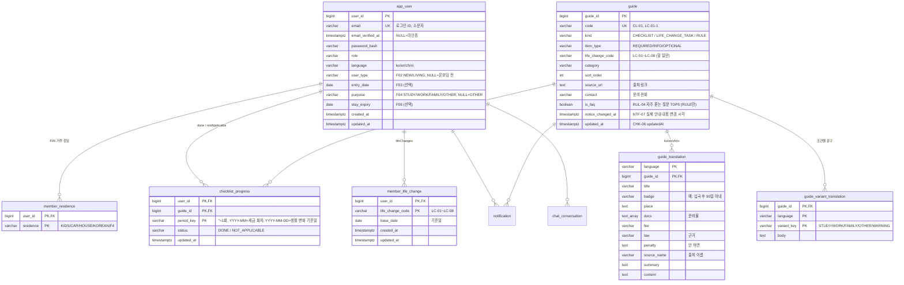

# DB ERD — 체크리스트 규칙표 반영 (2026-11-13)

기준 문서: **체크리스트 규칙표 (백엔드 전달용, 11/13)**. 마이그레이션:

- `V2026_11_14_0425__email_login_and_member_only.sql` — 아이디 = 이메일, 비회원 데이터 삭제 (이메일 인증·비밀번호 재설정·이메일 알림은 유지)
- `V2026_11_14_0430__checklist_rules_onboarding.sql` — 온보딩 답 5개, 거주 정보, 완료/해당 없음, 생활 변화, 항목 상세(CHK-06), 규칙표 항목 등록
- `V2026_11_14_0632__erd_review_integrity_indexes.sql` — 회차별 완료 기록, 외래키 삭제 동작, 중복 방지, 인덱스, refresh_token·display_name 삭제, CHECK, TIMESTAMPTZ

## 원칙

| 저장한다 (DB에만, CHK-9) | 저장하지 않는다 (요청마다 계산) |
|---|---|
| 온보딩 답 5개 + language | 표시 조건 평가 결과 |
| done[] / notApplicable[] | 마감일·D-day, TODO / OVERDUE |
| lifeChanges[] = { id, date } | 진행률, homeMode · urgentCount · nextTask |
| 항목 콘텐츠 (언어별 문구) | 정렬 순서 |

표시 조건·기한 계산식·알림 시점은 규칙표대로 **코드에서 정의**하고 `guide.code`(CL-01, LC-01-1 …)로 콘텐츠와 연결한다.
오늘 날짜는 서울 시간(Asia/Seoul) 기준이다.

## ERD (변경된 부분)

그 밖의 테이블(`calendar_schedule`, `event*`, `document*`, `guide_document_reference`, `chat_*`, `notification*`, `content_report`)은 Notion ERD 페이지에 컬럼까지 정리되어 있다. 모든 시각 컬럼은 `TIMESTAMPTZ` 이고 Java 에서는 `OffsetDateTime` 으로 매핑한다.

## 규칙표 ↔ 테이블

| 규칙표 | 저장 위치 |
|---|---|
| userType (F02, 필수) | `app_user.user_type` — NULL 이면 가입 직후 온보딩으로 이동 |
| entryDate (F03) | `app_user.entry_date` — 없으면 기한을 "OO일 이내"로만 표시, 알림 없음 |
| purpose (F04) | `app_user.purpose` — 건너뛰면 NULL, 계산 시 OTHER |
| residence[] (F05) | `member_residence` (행 없음 = 안 고름) |
| stayExpiry (F06) | `app_user.stay_expiry` — 없으면 CL-05 대신 입력 안내만 |
| language | `app_user.language` |
| done[] / notApplicable[] | `checklist_progress.status` — 회차(`period_key`)별 저장, 답을 바꿔도 지우지 않음 |
| lifeChanges[] { id, date } | `member_life_change` — 같은 변화 재등록 시 `base_date` 만 변경 |
| 항목 상세 (CHK-06) id, title, badge, place, docs[], fee, law, penalty, source, updatedAt | `guide.code`, `guide_translation.*`, `guide.source_url`, `guide.updated_at` |
| CL-04 조건별 문구 + 공통 경고 | `guide_variant_translation` (variant_key = 체류 목적 / WARNING) |
| 필수 11 · 안내 1 · 선택 3 | `guide.item_type` — 진행률은 REQUIRED 만 |

## 등록된 항목 (마이그레이션에서 ko 제목·근거 등록)

| code | 구분 | 제목 | 표시 조건 (코드) | 기한 (코드) |
|---|---|---|---|---|
| CL-01 | 필수 | 외국인등록 | userType=NEW AND NOT F4 | entryDate + 90일 |
| CL-02 | 필수 | 국내거소신고 | userType=NEW AND F4 | entryDate + 90일 |
| CL-04 | 필수 | 건강보험 가입 확인 | 항상 | 없음 (조건별 문구) |
| CL-05 | 필수 | 체류기간 연장 | stayExpiry 있음 | 시작 stayExpiry − 4개월 / 마감 stayExpiry |
| CL-06 | 필수 | 아르바이트 전 시간제 취업 허가 | purpose=STUDY | 없음 ("일하기 전") |
| CL-07 | 필수 | 직장을 바꿀 때 절차 알아두기 | purpose=WORK | 없음 ("바꿀 때") |
| CL-08 | 필수 | 가족센터 프로그램 보기 | purpose=FAMILY | 없음 ("언제든") |
| CL-09 | 필수 | 체류·취업 업종 상담 (☎1345) | purpose=OTHER | 없음 ("언제든") |
| CL-10 | 필수 | 자동차세 내기 | CAR | 매년 6/16~6/30, 12/16~12/31 |
| CL-11 | 필수 | 재산세 내기 | HOUSE | 매년 7/16~7/31, 9/16~9/30 |
| CL-12 | 필수 | 아이 학교 입학·전학 안내 | KIDS | 없음 ("3월 입학") |
| CL-13 | 안내 | 이사하면 거소 이전 신고 | userType=LIVING AND F4 | 없음 ("이사 시") |
| CL-20~22 | 선택 | 휴대폰 개통 / 은행 계좌 / 분리배출 요일 | userType=NEW | 없음 |
| LC-01-1~5 | 이사 | 체류지 변경(NOT F4, +15) · 거소 이전(F4, +14) · 자동차 주소(CAR, +30) · 자녀 전학(KIDS) · 쓰레기 배출 요일 | | |
| LC-02-1~4 | 이직 | 고용센터 사업장 변경(WORK) · 근무처 변경 신고(WORK, +15) · 시간제 취업 허가(STUDY) · 건강보험 직장 변경 | | |
| LC-03-1 | 입학 | 희망 학교에 입학 신청 | | |
| LC-04-1~2 | 차 구입 | 중고차 이전등록(+15) · 자동차보험 가입 | | |
| LC-05-1 | 출생 | 아기 체류자격 부여 신청 (+90) | | |
| LC-06-1 | 가족 입국 | 가족 외국인등록 (+90) | | |
| LC-07-1 | 출국 | 재입국허가 확인 (출국 전) | | |
| LC-08-1 | 이름·여권 변경 | 외국인등록사항 변경 신고 (+15) | | |

생활 변화 할 일 코드(`LC-01-1` 형식)는 규칙표에 없어서 백엔드에서 정했다. 규칙표의 변화 ID(LC-01)는 `guide.life_change_code` 와 `member_life_change.life_change_code` 에 그대로 쓴다.
en / zh / vi 문구와 장소·준비물·과태료 등 상세는 관리자 화면(또는 후속 마이그레이션)에서 채운다.

## 11/13 요구사항 수정으로 바뀐 것

| 요구사항 | DB 변경 |
|---|---|
| M-01·M-02 아이디 = 이메일 + 가입 인증 코드 | `app_user.login_id` 삭제, `email` NOT NULL + UNIQUE. `email_verified_at` 유지 — 새 회원은 가입 시 기록 (인증 코드는 Redis에만 보관) |
| M-11 비밀번호 재설정, NTF-05 이메일 알림, NTF-09 이메일 인증 | **유지** — 인증된 가입 이메일에만 발송. `notification.email_*` 유지 |
| ① 비회원 이용 없음 (CHK-9, CB-03, COM-01) | `chat_conversation.guest_session_id` 삭제 + `user_id` NOT NULL, `content_report.guest_session_id` 삭제, `app_user.*_updated_at`(기기값 병합용) 삭제 |
| CHK-8 입국 날짜만, 이사는 생활 변화 | `arrival_date` → `entry_date`, `move_date` 삭제 (LC-01 로 이동) |
| 이전 온보딩 정의서 대체 | `report_type`, `employment_status`, `region_code` 삭제 |

기존 회원 중 이메일이 없거나 겹치는 계정은 `{기존 login_id}@legacy.siot.invalid` 로 바뀌고 미인증 상태가 된다. 기존에 인증한 알림 이메일은 그대로 로그인 ID가 된다. 이전 온보딩 값(지역·이사일 등)은 새 규칙에 대응하는 값이 없어 버린다.

## 옛 버전 조각 임베딩 비우기, HNSW 인덱스 제거 (2026_11_23_0823)

| 문제 | 변경 |
|---|---|
| 재처리할 때마다 옛 버전 조각이 임베딩째 남아(현재 2,294개, 옛 4,243개) 검색 후보를 차지함. HNSW 는 후보 40개를 먼저 뽑고 현재 버전으로 걸러서 결과가 0개가 될 수 있음 | 현재 버전이 아닌 완료 버전 조각의 `embedding` 을 NULL 로 (행은 남김, CB-17). 이후 버전 전환 때도 같은 트랜잭션에서 비운다 |
| NULL 로 바꿔도 VACUUM 전에는 인덱스에 남고, 옛 조각이 없어도 근사 검색이라 가장 가까운 조각을 놓침 | `idx_document_chunk_embedding`(HNSW) 삭제. 검색은 현재 조각 전체 정확 검색 (조각 수천 개 규모) |

- 실패·처리 중 버전은 건드리지 않는다. 조각 저장과 버전 전환이 한 트랜잭션이라 보통 조각이 없고, 재실행(retry) 은 임베딩을 새로 만든다.
- 비운 임베딩은 되돌릴 수 없다 (문서 재처리로만 다시 생긴다). 인덱스는 `CREATE INDEX idx_document_chunk_embedding ON document_chunk USING hnsw (embedding vector_cosine_ops)` 로 다시 만들 수 있다.
- 현재 조각이 1만 개를 넘어 검색이 느려지면 인덱스를 다시 검토한다 (그때는 `hnsw.ef_search`·`hnsw.iterative_scan` 과 VACUUM 을 같이 정한다).

## ERD 검토 반영 (0632)

| 문제 | 변경 |
|---|---|
| 생활 변화를 다시 등록하면 예전 완료 기록이 남음 | `checklist_progress.period_key` = 생활 변화 기준일(YYYY-MM-DD) → 새 기준일의 할 일은 다시 TODO |
| 매년 돌아오는 세금(CL-10·11)이 한 번 완료하면 계속 완료 | `period_key` = 납부 회차(YYYY-MM, 납부 시작 월) |
| 행사·항목·문서를 지울 수 없음 (ON DELETE 없음) | 번역·구독·근거 연결·문서 하위는 CASCADE, 알림·신고·일정·답변 근거는 SET NULL |
| 같은 알림이 두 번 생길 수 있음 | UNIQUE `notification(user_id, source_key)` |
| 문서 버전·조각 번호 중복, 현재 버전 여러 개 | UNIQUE `(document_id, version_no)`, `(document_version_id, chunk_no)`, 부분 UNIQUE `document_version(document_id) WHERE is_current` |
| 알림 대상 4개 중 하나만 써야 하는데 강제 안 됨 | CHECK `num_nonnulls(...) <= 1` |
| 외래키·목록 조회 인덱스 없음 | 알림·대화·메시지 목록, 행사 시작일, 신고 상태, FK 반대쪽 인덱스 추가 |
| 쓰지 않는 테이블·컬럼 | `refresh_token` 삭제, `app_user.display_name` 삭제 |
| 허용 값 제한 없음 | `role`, `guide.kind`, 언어 컬럼, `notification.email_status` CHECK |
| 시간대 없는 시각 | 모든 `TIMESTAMP` → `TIMESTAMPTZ` (Java `OffsetDateTime`) |

세금 납부 기간(CL-10 6/16~6/30·12/16~12/31, CL-11 7/16~7/31·9/16~9/30)은 체크리스트 규칙(코드)이 기준이다. `calendar_schedule` 은 주민세처럼 체크리스트 항목이 아닌 공통 일정에 쓴다.

## 생활수칙·안내 변경 표시 (0900)

| 요구사항 | DB 변경 |
|---|---|
| 생활수칙 콘텐츠 | `guide.kind` 에 `RULE` 추가 — 문구는 체크리스트와 같이 `guide_translation` 에 언어별 저장 |
| RUL-04 자주 묻는 질문 TOP5 | `guide.is_faq` (CHECK: `RULE` 만 true 가능) — `sort_order` 순 상위 5개, 부분 인덱스 `ix_guide_faq` |
| NTF-07 안내 변경 표시 | `guide.notice_changed_at` — 실제 안내 내용이 바뀐 시각. `updated_at` 은 오타 수정에도 바뀌므로 구분. NULL = 등록 후 바뀐 적 없음 |

반복되는 일(세금 회차·생활 변화 재등록)의 완료 기록은 지우지 않고 `checklist_progress.period_key` 회차별로 쌓는 방식(A)을 유지한다.

## 고지서 최근 번역·마감 알림, 행사 알림 시점, 이메일 수신 설정 (2026_11_26_1300, 1400)

| 요구사항 | DB 변경 |
|---|---|
| RUL-07 최근 번역 저장 | `bill_translation` — 사진은 저장하지 않고 개인정보를 가린 결과 JSON(`result`)과 목록용 값(서식·기관·세목·금액·기한)만. 회원당 최근 10개 (기한 전 마감 알림이 켜진 것은 남김). 회원 삭제 시 CASCADE |
| RUL-07 납부 마감 알림 | `bill_translation.reminder` (기한이 있어야 true, CHECK). 매일 9시 D-7·D-1 에 `notification.kind = BILL_DUE`, `notification.bill_translation_id` (번역 삭제 시 SET NULL, 알림 대상 하나 CHECK 에 포함). 설정은 TAX 를 따른다 |
| NTF-02 행사 알림 받을 시점 | `event_subscription.lead_days` (1: 24시간 전(기본) / 3 / 7: 그날 오전 9시) |
| NTF-03·05 이메일 수신 설정 | `notification_preference.email_enabled` (기본 true). 발송 시점에 보고 꺼져 있으면 `notification.email_status = SKIPPED` |

## 알림 시점 선택, 행사 변경 즉시 알림, 생활수칙 FE 구조 (2026_11_26_1500 ~ 1610)

| 요구사항 | DB 변경 |
|---|---|
| NTF-03 사전 알림 시점 (BE #16) | `notification_preference.lead_days_list` INTEGER[] — 받을 D-n 들. NULL = 기본 시점 전부. 예전 `lead_days` 는 쓰지 않음 |
| NTF-02 일정 변경 즉시 알림 (BE #15) | 스키마 변경 없음. 수집·관리자 수정 커밋 뒤 `NotificationEventChangeNotifier` 가 만들고, 매시 작업은 보완 |
| 생활수칙 FE 구조 (BE #14) | `guide_translation.points`(문장 목록)·`timing`(시기)·`contact`(언어별 문의처)·`reviewed`(사람이 확인한 번역, 자동 번역이 덮어쓰지 않음), `guide.checked_on`, `guide_source`(출처 목록), `rule_category`(FE 키·순서), `rule_faq`·`rule_faq_translation`(FAQ 질문·답변) |
| 생활수칙 시드 | `V2026_11_26_1610__seed_fe_rules.sql` — `scripts/generate_rule_seed.mjs` 로 Siot-FE `src/features/rules/content.ts`·`messages.ts` 에서 만든다 (손으로 고치지 않음). 18개 항목·FAQ 5개·카테고리 6개·4개 언어 |
